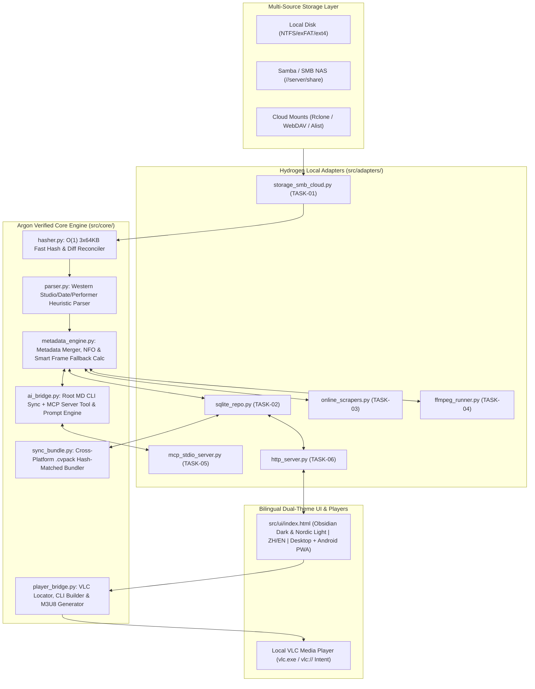

# System Architecture & Core Design (Built by Argon)

## 1. Architectural Overview

**CineVault Studio** separates complex algorithmic and state-reconciliation logic (**Argon Core Engine**, zero external network dependencies, 100% unit-tested in sandbox) from local OS/network integration (**Hydrogen Adapters**).

---

## 2. Core Bottlenecks Solved by Argon

1. **O(1) Partial Composite Hashing (`src/core/hasher.py`)**:
   - Full SHA-256 hashing of a 15GB 4K video over a 1Gbps Samba share takes ~130 seconds per file.
   - Argon solved this with `compute_fast_fingerprint()`, which reads three 64KB windows (`offset 0`, `offset size // 2`, `offset size - 64KB`) and hashes them together with the exact 64-bit byte size using `blake2b`. Files `<= 192KB` are hashed in full.
   - `reconcile_library_state()` compares a fresh scan against stored `MediaItem` records and deterministically detects **Added**, **Unchanged**, **Moved/Renamed** (preserving `item_id`, user star ratings, tags, and play history while seamlessly updating the file path), **Content Modified**, **Missing**, and **Duplicate** files.

2. **Western Adult Media Filename & Directory Hierarchy Parser (`src/core/parser.py`)**:
   - Western adult releases follow distinct naming conventions compared to Asian/JAV codes. Argon built a multi-pass regex + token parser supporting:
     - Scene dot-notation: `BrazzersExxtra.24.10.15.Jane.Doe.And.John.Smith.Scene.Title.XXX.1080p.MP4`
     - Bracketed studio & date: `[Vixen] (2025-03-12) Eve Sweet - Sunset Villa [4K].mkv`
     - Dash-separated hierarchy: `Tushy - 2024-08-20 - Kelly Collins - Parisian Nights.mp4`
     - Parent directory inheritance: `/Media/Blacked/2025/Lana Rhoades - Night Out.mp4` (automatically inherits `studio="Blacked"` and `release_date` year from ancestor folders when missing from the filename).
   - Built-in normalized dictionary of 60+ major Western studios/networks (MetArt, Vixen, Tushy, Blacked, Deeper, Slayed,Dorcel, Brazzers, NaughtyAmerica, RealityKings, BangBros, DigitalPlayground, EvilAngel, Twistys, TeamSkeet, AdultTime, Wicked, JulesJordan, etc.) with fuzzy canonical mapping.

3. **Smart Cover Fallback & Metadata Merging (`src/core/metadata_engine.py`)**:
   - Combines parsed local tokens + user-supplemented keywords (`user_keywords`) to build high-precision search queries.
   - Calculates optimal FFmpeg frame extraction timestamps (`compute_smart_frame_timestamp()`) at `18%` of video duration (clamped between `15.0s` and `300.0s`) with secondary fallback probes (`25%`, `35%`) to avoid intro logos and black frames.
   - Preserves user edits (`rating_half_steps`, `user_keywords`, `custom_tags`, `locked_fields`) across refreshes.

4. **Dual-Mode AI Metadata Completion Engine (`src/core/ai_bridge.py`)**:
   - **Mode 1 (Root Markdown CLI Workflow)**: Exports incomplete items and a studio/performer/tag keyword glossary into `AI_KEYWORD_DB.md` with structured YAML/JSON blocks, and parses AI-completed Markdown files back into `MediaItem` updates with strict validation.
   - **Mode 2 (MCP Server & One-Click Prompt Builder)**: Implements full MCP JSON-RPC 2.0 request/response dispatch (`tools/list`, `tools/call`) plus `build_interactive_ai_prompt()` so users can copy-paste a single prompt block into ChatGPT/Claude/Gemini web UI and paste back the JSON result.

5. **Cross-Platform Hash-Verified `.cvpack` Sync Bundle (`src/core/sync_bundle.py`)**:
   - Packages library metadata, playlists, ratings, and cover images into a portable `.cvpack` archive.
   - On Android or a secondary PC, `reconcile_sync_bundle()` matches incoming records to local storage files by `fast_hash` (with `(file_size, filename)` fallback), automatically remapping Windows paths (`E:\Vault\...`) to Android paths (`/storage/emulated/0/Movies/...`) or SMB URLs (`smb://...`).

---

## 3. Strict Invariants & Guardrails for Hydrogen

- **Invariant 1 (Read-Only Core)**: Never modify files in `src/core/` or `tests/test_core.py`. All Hydrogen adapters in `src/adapters/` must import data models and core functions from `src/core/`.
- **Invariant 2 (Half-Star Rating Precision)**: Ratings are stored as both `rating` (`float` in `{0.0, 0.5, 1.0, ..., 5.0}`) and `rating_half_steps` (`int` in `0..10`). Always validate ratings through `MediaItem.set_rating()`.
- **Invariant 3 (Hash-First Identity)**: Never use file path as the primary key when syncing or refreshing. `fast_hash` is the canonical content identity across moves, renames, and Windows-to-Android `.cvpack` imports.
